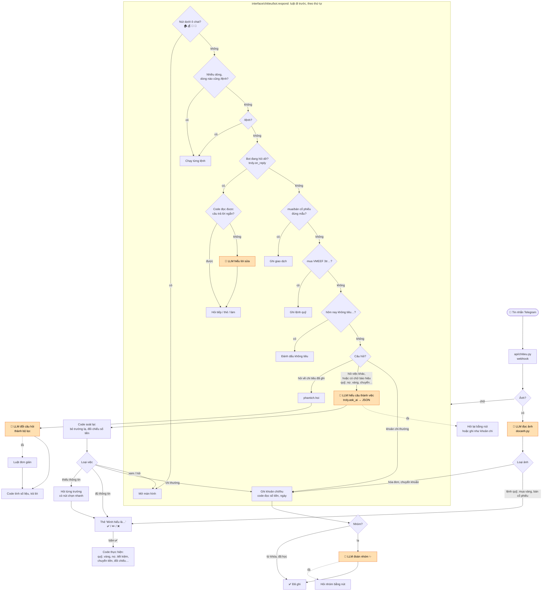

# Bot chi tiêu: một tin nhắn đi qua những đâu

Code không gửi mọi tin cho LLM. Các bước dùng luật (code) chạy trước, theo thứ tự trong `bot.respond (interface/chitieu)`. LLM (Gemini
gói miễn phí, OpenRouter dự phòng) chỉ được gọi ở các ô màu cam.

| Bước | Ai làm | Khi nào |
|---|---|---|
| Nút, /lệnh, câu trả lời ngắn, mua/bán đúng mẫu, «không tiêu» | Code | Mọi lúc, không cần LLM |
| Khoản chi thường («cà phê 35k») | Code đọc số tiền; LLM chỉ đoán nhóm khi gặp ghi chú lạ | Phần lớn tin nhắn |
| Câu hỏi về chi tiêu | LLM đổi câu hỏi thành bộ lọc, **code tính số** | Câu có dấu hỏi, «bao nhiêu», «nhiều nhất»… |
| Việc tài chính (quỹ, vàng, nợ, chuyển tiền…) | **LLM hiểu ý**, code soát lại, người dùng bấm ✅ | Câu có chữ báo hiệu hoặc không có số tiền |
| Ảnh | LLM đọc ảnh | Mọi ảnh |

Bấm nút không bao giờ gọi LLM. LLM không bao giờ tự ghi gì: việc nào LLM hiểu ra cũng phải qua thẻ ✅, trừ khoản chi
thường (ghi ngay, có nút ✏️ sửa nhóm, ❌ xóa).
